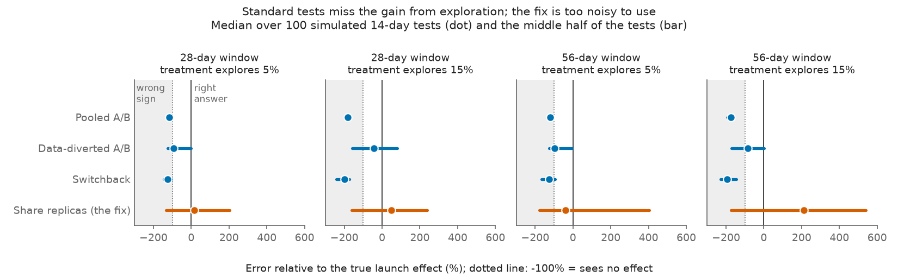

# Why A/B tests reject exploration in self-training recommenders

A recommender that retrains every day on its own logs can learn from exploration: showing some random items costs
clicks today but finds good new items sooner. This project simulates such a system, compares four ways of testing
more exploration against the true long-run launch effect, and tests one natural fix, which fails.

Why it matters: a standard two-week A/B test of a change that alters the training data (exploration, a new
candidate source) can measure the wrong sign and lead a team to reject a change that pays off after launch. The
problem is known (see related work in the readout); this project shows it in a small simulation where the truth is
known, and reports an honest negative result for the fix.



## Results

- Pooled-log A/B tests and switchbacks get the sign wrong in all four settings (median errors -117% to -199% of a
  true gain of about 3 click-rate points): with one shared model they see the cost of exploration, not its gain.
- Data-diverted tests (each arm trains on its own logs) see 3% to 56% of the gain, and their estimates spread
  more widely across tests than the size of the gain.
- The fix, model replicas trained on a randomized treated share of the data and extrapolated to full launch, is too
  noisy (SD 3 to 5 times the gain; 10 times the traffic does not help) and biased, because the gain builds up item by
  item over each item's life. Four variants did not rescue it.

Details, numbers and practical guidance are in [docs/readout.md](docs/readout.md); the plan and the checks are in
[design.md](design.md).

## How to run

Python 3.12 with numpy and matplotlib. `run_all.py` sets OPENBLAS_NUM_THREADS=1 itself.

```
py -3.12 scripts/run_all.py              # simulations -> results/ (about 5 minutes)
py -3.12 scripts/make_figures.py         # figures/ from results/*.json
py -3.12 scripts/check_reproduction.py <research results folder>
```

The results were first obtained in a pre-registered research check. `check_reproduction.py` compares this rerun
with that run's result files (not included here) and prints PASS or FAIL: every number is identical.

## Limits

A toy world: a count-based model, top-1 serving, 5% of items replaced a day, 14- or 28-day tests, 28- or 56-day
training windows. It shows a mechanism, not the size of the effect in any real system. Models that share
information across items (embeddings, features) may build up the gain differently.

Can Zhang. MIT license.
