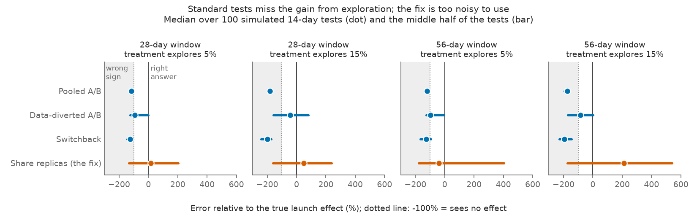
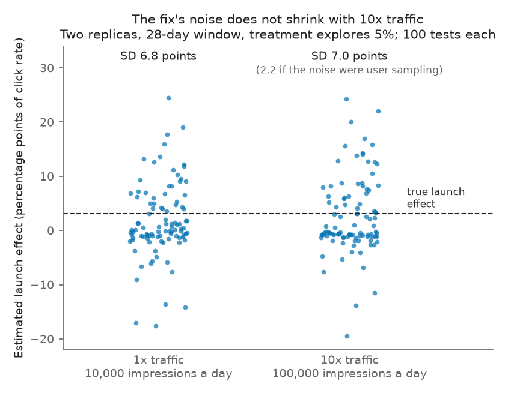

# Readout: testing exploration in a self-training recommender

## The decision

A team wants to raise the exploration rate of a recommender: show a random item a little more often instead of the
item the model scores highest. The model is retrained every day on the last W days of its own logs, and new items
keep arriving (here 5% of the catalogue is replaced every day). Exploration costs clicks now, because random items
are worse on average, and pays later, because good new items get impressions and the model learns about them
sooner. The decision needs the launch effect: the long-run click rate with all traffic on the new policy and every
model trained on its own data, minus the same for the old policy.

In the simulation the launch effect is known from 200 long runs per policy. Raising exploration from 1% to 5% or 15%
gains 2.7 to 3.2 click-rate points (Monte Carlo SE about 0.3) in all four settings: training window of 28 or 56 days,
treatment exploring 5% or 15%. The right decision is to launch.

## What each test design estimates

Every test lasts 14 days, splits traffic 50/50 and starts from the same control world; there are 100 simulated tests
per design and setting. Errors are relative to the launch effect: -100% means the test sees no effect, below -100% it
has the wrong sign.

| Design | Training during the test | Median error, four settings |
| --- | --- | --- |
| Pooled A/B | one model on both arms' logs serves both arms | -117% to -183% |
| Switchback | one model; all traffic switches policy day by day | -125% to -199% |
| Data-diverted A/B | each arm's model trains on its own arm's logs | -44% to -97% |
| Share replicas (the fix) | replicas with a randomized treated share of data | -40% to +212% |

**Pooled A/B and switchback** get the sign wrong in every setting. The shared model learns from the treated arm's
exploration and serves both arms, so the control arm gets the benefit for free and the contrast keeps only the cost.
The median estimate is a loss of 0.5 to 2.3 points (pooled) or 0.8 to 2.9 points (switchback) where the truth is a
gain of about 3. Pooled estimates are also precise (SD 0.3 to 0.7 points): 399 of the 400 pooled tests had the wrong
sign, so the test is confidently wrong. A team would reject the launch.

**Data-diverted A/B** is the right idea but sees only part of the effect: after 14 days the treated model's window
holds at most 13/W of treated data (46% or 23%). It sees 3% to 56% of the gain, and its estimates spread more than
the gain itself (SD 3.9 to 4.2 points), because each arm is one training path: which new items a model happens to
learn about early decides its click rate for days.

## The fix and why it fails

The fix trains three model replicas that differ only in the share of their test-period training data that comes
from the treated arm (none, half or all). Users are randomized to an arm and a replica. Per arm, clicks are regressed
on the treated share s of the replica's training window, and the fit is extrapolated to s = 1, the launch state.

Its median errors are +17%, +48%, -40% and +212%, and its SD across tests is 3.3 to 5.3 times the effect. The
pre-registered verdict was MARGINAL: not bad enough to kill by the registered rule, nowhere near usable. Four
follow-up variants did not rescue it:

| Variant | Median error, four settings | SD / effect |
| --- | --- | --- |
| Two replicas (all or no treated data), 14 days | -92% to +72% | 2.2 to 5.0 |
| The same with 28-day tests | -138% to -19% | 1.0 to 2.0 |
| Learning-curve extrapolation instead of linear | -102% to -57% | 2.0 to 4.6 |
| Replicas trained only on test-period logs | -185% to -117% | 0.4 |

Two reasons, both visible in the numbers:

1. **Trajectory noise.** Each replica is a single training path, and all users of a replica share it. More users do
   not average it out: with 10 times the traffic (and the same training volume) the SD of the two-replica estimate
   stays at 7.0 points against 6.8; had the noise come from sampling users, it would have fallen to 2.2
   (figure below). Only more independent replicas or longer tests reduce it, and each replica
   is a model to train and serve.
2. **The share of treated data is not the state that matters.** The gain builds up item by item over each item's
   life. At launch, every item has been explored under the new policy since the day it arrived. In a test, most
   items spent most of their lives under the old policy, whatever share of the recent window is treated. So even
   replicas trained only on treated data fall short: the replicas trained only on test-period logs get the sign wrong
   in every setting, and 28-day tests, whose treated replica's window is almost all treated by the end at W = 28,
   still miss by -88% and -138% there. Extrapolating in the share cannot recover a gain stored in item histories. A
   short extrapolation range adds to it: with s at most 0.23 at W = 56 the linear fit overshoots (+212%), and the
   learning-curve fit put its rate parameter at a grid end in 53% to 70% of the tests.

## What a team can do instead

Practical guidance that follows from the mechanism. It was not tested here, and each point has limits.

- **Read a pooled-log test of a data-generating change as a lower bound** on its long-run value when the change
  should make the training data better (more exploration, more diverse logs). Here it fell short of the truth by
  more than the size of the effect. Do not reject such a change on it alone. If the change could make the data worse,
  the same bias hides the harm instead.
- **Keep a long-running holdout**: a small slice of traffic stays on the old policy with its own model trained only
  on its own logs, for longer than the training window plus a typical item lifetime (here 28 or 56 days plus about
  20). Limits: a small holdout's model sees less data unless both sides train on the same volume, as they do in this
  simulation; one holdout is one training path, so expect trajectory noise and watch the gap over time; its users pay
  the cost of the old policy.
- **Hold ramp-ups long enough**: hold each ramp stage longer than the training window before reading it, against the
  holdout. A stage that still shares one model between arms has the pooled-test bias.
- **If a test must be short, divert the data** and report that it sees only part of the effect (in a test of T days
  with window W, roughly T/(2W) of the window has changed on average).

## Related work

The problem is known; this project only shows it in a small simulation with known truth.

- Brennan et al., "Reducing Symbiosis Bias Through Better A/B Tests of Recommendation Algorithms", WWW 2025, arXiv
  2309.07107. Bias when arms share training data, and test designs that reduce it.
- Zheng and Zhao, "Algorithm Adaptation Bias in Recommendation System Online Experiments", arXiv 2509.00199. A test
  at a small treated share differs from full deployment; training on data from the dominant policy is one cause.
- Li, Wang and Wang, "Choosing the Better Bandit Algorithm under Data Sharing: When Do A/B Experiments Work?", arXiv
  2507.11891. With one shared history the A/B estimate can have the opposite sign to the global effect.
- Si, "Tackling Interference Induced by Data Training Loops in A/B Tests: A Weighted Training Approach", arXiv
  2310.17496. Data-splitting estimates are noisy; weighted training as a fix.
- Xiong, Chin and Taylor, "Data-Driven Switchback Experiments", arXiv 2406.06768. Switchback bias when carryover
  lasts longer than a block.
- Shen, Yan, Li and Zhu, "Content Exploration Beyond the Feed: Creator Supply and the Shared Corpus", arXiv
  2608.29430. A short test sees only part of a slow corpus effect, and more users do not help.
- Guo et al. (Meta), "Evaluating Online Bandit Exploration In Large-Scale Recommender System", arXiv 2304.02572.
  Online tests of exploration with a shared-model phase and a split-model phase.

## Where the numbers come from

The results were first obtained in a pre-registered research check (verdicts KT1 MARGINAL, KT2
MARGINAL, KT3 KILL; the line was stopped). This project reruns the same code with the same seeds. The positive
controls pass and every stored number matches the research run (checks P1 and P2 in `design.md`). Numbers above come
from `results/designs_score.txt` and `results/fix_variants_score.txt` and the JSON files beside them.
